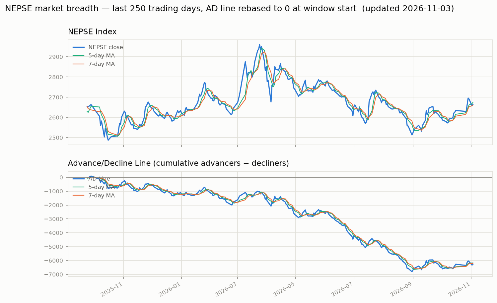

# nepse-data

nepse-data is the collection of all the datasets (from past to present) of various companies listed in the Nepal Stock Market. This repository is built for the students and people who want to perform analysis on Nepal Stock Market using historical (& current) data.

## Data

The data can be found in the [data/company-wise](https://github.com/Aabishkar2/nepse-data/tree/main/data/company-wise) folder, one CSV per company, named by its trading symbol. For example: in `NMB.csv` you can find all the data of NMB Bank Limited sorted in ascending order (date-wise).

The repository currently includes data for around 370 companies, with history going back as far as 1995. Feel free to create an issue if you want data of any particular company urgently.

Each CSV has the following columns:

| Column | Description |
| --- | --- |
| `published_date` | Trading date (`YYYY-MM-DD`) |
| `open` | Opening price |
| `high` | Day's high |
| `low` | Day's low |
| `close` | Closing price |
| `per_change` | Percentage change from the previous close (`nan` for the first row of a series) |
| `traded_quantity` | Number of shares traded |
| `traded_amount` | Total turnover for the day |
| `status` | Derived: `1` if close > open, `-1` if open > close, `0` if equal |

The Github Actions updates the data on an almost daily basis so that the datasets available here are up to date.

## Code

The code through which the data were/are being collected resides in the [src/](https://github.com/Aabishkar2/nepse-data/tree/main/src) folder. The code is written in `python3.8` and the required libraries are listed in `src/requirements.txt`.

If you want to collect the datasets by yourself then you can run the following commands.

Firstly, Just make sure you have `python3` installed 😉. If not please find python3 installation procedure over [here](https://www.python.org/downloads/)

```bash
# go into the src folder -- the scrapers must be run from here
cd src

# install requirements
pip3 install -r requirements.txt

# refresh the symbol -> company-id map from the live site
# (run this before a backfill so newly listed companies are picked up)
python3 discoverCompanies.py

# for historical data collection
# this only seeds companies that don't have a CSV yet -- existing files are left alone
python3 allDataScrapper.py

# optional -- for daily data updates
python3 dailyDataScrapper.py
```

A few things worth knowing:

- All three scripts import using paths relative to `src/`, so they only work when run from inside that directory.
- `discoverCompanies.py` regenerates `src/constants/companyIdMap.py`. That file is generated — don't hand-edit it. It merges with the existing map, so delisted companies are never dropped.
- `allDataScrapper.py` skips any symbol that already has a CSV, so re-running it won't clobber or duplicate existing data.
- `dailyDataScrapper.py` only appends to CSVs that already exist and is idempotent — running it twice in a day won't add a duplicate row.

The code that updates data on a daily basis resides in the `.github/workflows` directory and runs on Github Actions as a CRON job. The workflow runs 5 times every day (Sunday to Friday) so that if the data collection is missed the first time then it will work the second time and so on.

## Market breadth (advancers/decliners, AD Line, NEPSE index)

This fork adds a market-breadth pipeline on top of the company-wise data above.
It runs daily via `.github/workflows/update-breadth-chart.yml` (after the main
data-collection workflow) and produces:

- `data/market-breadth.csv` — one row per trading day: `advancers`, `decliners`,
  `unchanged`, `total_traded`, counted from every company-wise CSV.
- `data/nepse-index.csv` — the NEPSE index's own daily `open/high/low/close`,
  pulled separately from ShareSansar's index history (index_id 12), back to
  1997-07-20. This is the overall market index, not any single company's price.
- `data/combined.csv` — the two merged, plus `net_advances` (advancers −
  decliners), `ad_line` (cumulative net_advances since 1995 — the classic
  Advance/Decline Line), and 5-day/7-day moving averages of both the AD line
  and the NEPSE close.
- `charts/ad_line_recent.png` — last 250 trading days (AD line rebased to 0 at
  the window start, so short-term moves are visible against a ~30-year-old
  cumulative total).
- `charts/ad_line_full.png` — the full history.



Scripts live in `scripts/` and run in order: `fetch_nepse_index.py` →
`build_breadth.py` → `build_combined.py` → `plot_chart.py`.

## Contributing

Pull requests are welcome. Please open an issue first to discuss what you would like to change.

Things you can consider doing:

- Github action to update data on a daily basis on Kaggle
- Date-wise Collection of data from past to present

## License

[MIT](https://choosealicense.com/licenses/mit/)
